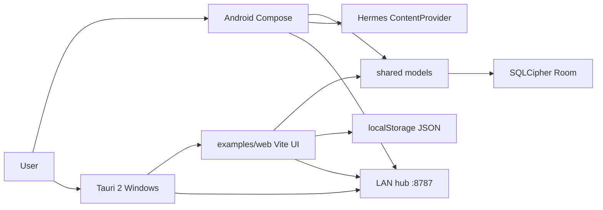

# Phase 0 inventory — AetherFeed

> Snapshot of **what ships in the tree today** versus **where the brief, specs, and ADRs point**. This is Phase 0 of a multiplatform migration (Android, iOS, Windows, macOS, Linux; feature and design parity; prefer shared logic/UI; leave pure-PWA parts as web unless a native shell adds device-level value).
>
> Binding follow-ons: [`DESIGN_BRIEF.md`](DESIGN_BRIEF.md), [`TECH_DECISION.md`](TECH_DECISION.md), [ADR-0013](../adr/0013-compose-multiplatform.md). No app-code change in this phase.
>
> **Honesty rule:** marketing copy, `COMPLETED_TASKS.md` sprint titles, and some feature-spec tables overclaim. Status below is from the source tree, not from those titles.

**Sources:** [`AGENT.md`](../../AGENT.md), [`AGENTS.md`](../../AGENTS.md), [`BUILD_PLAN.md`](../../BUILD_PLAN.md), [`README.md`](../../README.md), [`docs/spec.md`](../spec.md), [`docs/plan.md`](../plan.md), [`docs/features/`](../features/), [`docs/adr/`](../adr/), [`branding/product.json`](../../branding/product.json), `.multi-platform/`, GitHub issues/PRs (2026-11-16).

**Status labels**

| Label | Meaning |
|-------|---------|
| **WORKING** | User-visible and wired on that surface |
| **PARTIAL** | Real UI or logic, incomplete vs the spec |
| **LOGIC-ONLY** | Code + tests exist; not wired to UI and/or production DI |
| **STUB** | Explicit stub, demo data, or empty implementation |
| **TEMPLATE** | Golden Path / agent-project-bootstrap leftover |
| **MISSING** | Specified or marketed; not in this tree |
| **ABSENT** | Platform or stack not present |

---

## 1. Current State

### 1.1 Verdict

The app is **not** an empty Golden Path placeholder, and it is **not** a finished three-module product.

- **Identity is stub-era:** `org.aetherfeed.app`, `versionCode` 1, `versionName` `0.1.0` (`schemas/golden-path/app-version.json`, `examples/android/app/build.gradle.kts`, Tauri `0.1.0`). Fastlane/F-Droid changelogs still say “initial stub.” User-facing copy still says “AetherFeed stub” and “lands in Sprint 2/3/4.”
- **Real product code exists:** encrypted Room/SQLCipher vault, RSS/Atom/JSON ingest + in-app news reader, Hermes + home-LAN ciphertext pool, Settings/About/theme, unread home widget, GitHub-release update check.
- **Largest holes vs the brief:** podcast playback UI (Android), live booru, posted notifications, Drive/WebDAV in production DI, OPML/export UI, iOS (no stack), desktop packaging only Windows NSIS/MSI, web library in `localStorage` (not SQLCipher).

GitHub (2026-11-16): **no product issues**. The only open PR is Release Please [#50](https://github.com/edwardlthompson/aetherfeed/pull/50) (`chore(main): release 1.13.4`) — template version, not app `0.1.0`.

### 1.2 Identity, stacks, and template residue

| Item | Value | Path |
|------|-------|------|
| Product | AetherFeed | [`AGENTS.md`](../../AGENTS.md) project card, [`AGENT.md`](../../AGENT.md) |
| Purpose | Local-first encrypted news, podcast, and booru client | Same |
| Application id | `org.aetherfeed.app` | `examples/android/app/build.gradle.kts`, `examples/desktop/src-tauri/tauri.conf.json` |
| Android version | `versionCode` 1, `versionName` 0.1.0 | `build.gradle.kts` ← `readGoldenPathAppVersion()` |
| Desktop / web version | 0.1.0 | `examples/desktop/package.json`, `examples/web/package.json`, `examples/rust/Cargo.toml` |
| Template version (repo) | 1.13.3 (Release Please heading toward 1.13.4) | README badge, `.template-version` |
| minSdk / targetSdk / compileSdk | 26 / 37 / 37 | `examples/android/app/build.gradle.kts` |
| Distribution tier | FOSS MIT | `.cursor/stack-selection.json` `distribution_tier: foss` |
| Active modules | android, web, rust, desktop | `.cursor/stack-selection.json` |
| Inactive / pruned | python, node, go, lightroom | No `examples/` trees |
| iOS | **ABSENT** | No `examples/ios`, no Xcode project, no MODULE |
| macOS / Linux packages | **ABSENT** | Tauri `bundle.targets`: `["nsis", "msi"]` only |
| Public PWA | **Disabled on purpose** | `branding/product.json` `pages_demo: false`; KB-018 |

**TEMPLATE leftovers (not product behavior):**

- `readGoldenPathAppVersion()` and `schemas/golden-path/app-version.json`
- Signing env `GOLDENPATH_UPLOAD_*` in `examples/android/app/build.gradle.kts`
- `metadata/dev.foss.goldenpath.yml` (F-Droid recipe still named for the template)
- Service worker cache prefix `golden-path-v*` in `examples/web/public/sw.js`
- `gp.*` i18n / localStorage keys (`feedback/saveCrashes.ts`, crash-capture)
- `examples/web/src/greet.ts` “Hello, world!” (online helper only)
- Test package `dev.foss.goldenpath.crashcapture.PendingCrashTest.kt`
- Feature specs still name `GoldenPathApp.kt` / `GoldenPathScreen.kt` as composition roots; actual roots are `AetherFeedApp.kt` / `MainActivity.kt`
- `docs/plan.md` still lists Room+SQLCipher as 🔲 — **stale**; vault is wired

### 1.3 Surfaces that exist today



| Surface | Role today | Maturity |
|---------|------------|----------|
| `examples/android/` | Primary FOSS client | Vault + news **WORKING**; podcasts/booru/notify **PARTIAL/STUB** |
| `examples/web/` | Shared UI for Tauri + local Vite; **not** a hosted product | News **WORKING** (CORS-limited in browser); podcasts **PARTIAL**; booru **STUB** |
| `examples/desktop/` | Tauri 2 WebView + tray + LAN hub + crypto | Thin native; Windows packaging only |
| `examples/rust/` | `aetherfeed-crypto` (Argon2id + XChaCha20-Poly1305) | **WORKING** library |
| `shared/typescript/` | Cross-language domain + sync + unread | **WORKING** types/tests |
| `modules/*` | Agent docs only | No shared Gradle/KMP library |

### 1.4 Navigation flow

**Android** — no `NavHost`. Bottom bar + overlays.

```
Launch MainActivity
  → AetherFeedTheme (system/light/dark)
  → AetherFeedScreen
       ├─ Bottom: News | Podcasts | Booru  (persisted in DataStore)
       ├─ Top: title + Settings
       ├─ FAB: Add subscription (News / Podcast / Booru kind chips)
       ├─ Overlay: Settings
       └─ Overlay: About (from Settings)
News tab → article list → ArticleReaderScreen (or external browser)
Podcasts tab → show list or empty Sprint-3 copy
Booru tab → demo grid → post detail
```

| Piece | Path | Status |
|-------|------|--------|
| Destinations | `examples/android/.../ui/navigation/AppDestination.kt` | **WORKING** — News, Podcasts, Booru |
| Bottom / top bar | `ui/AetherFeedChrome.kt` | **WORKING** |
| Body router | `ui/AetherFeedBody.kt` | **WORKING** |
| Tab persistence | `browse/BrowsePrefs.kt` | **WORKING** |
| Legacy pane | `ui/navigation/ModulePane.kt` | **TEMPLATE** — unreachable for current enum |
| ViewModels | — | **MISSING** — state in composables + `lifecycleScope` |

**Web / desktop** — no URL router.

| Piece | Path | Status |
|-------|------|--------|
| Shell | `examples/web/src/AppShell.ts` | **WORKING** — module tabs + ⚙ Settings + i About + theme toggle |
| Tab mount | `examples/web/src/moduleHome.ts`, `moduleHomeNav.ts` | **WORKING** — `news` \| `podcasts` \| `booru` |
| Active tab | `settings/browsePrefs.ts` `af-active-module` | **WORKING** |

### 1.5 Screens (exhaustive)

#### Android

| Screen | File | What the user gets | Status |
|--------|------|--------------------|--------|
| App root | `ui/AetherFeedApp.kt` | Theme, update check, donations, injects repos/sync | **WORKING** |
| Main shell | `ui/AetherFeedScreen.kt` | Loads vault lists; **hard-codes two demo booru posts** | **PARTIAL** |
| News list | `ui/news/NewsScreen.kt` | Filters (all/unread/starred, newest/oldest), star, open article | **WORKING** |
| Article reader | `ui/news/ArticleReaderScreen.kt` + `ArticleReaderBlocks.kt` + `ArticleSwipeOverlay.kt` | Reading / Full / Web modes, fetch HTML, extract, swipe prev/next, park unread | **WORKING** |
| Podcasts | `ui/podcasts/PodcastsScreen.kt` | Feed title/URL list + browse tree; empty copy is Sprint 3 stub; **no player** | **STUB** UI |
| Booru grid/detail | `ui/booru/BooruScreen.kt` | Real grid/detail/star chrome on **demo JSON** (`example.test` URLs); stars in memory, not vault | **STUB** data / **PARTIAL** UI |
| Settings | `ui/settings/SettingsScreen.kt` + `SettingsReaderSection.kt` | Theme, update toggle, Hermes status, LAN hub URL/passphrase, reader prefs | **WORKING** |
| About | `ui/about/AboutScreen.kt` | Version, format, update apply, donations links, export **hint only** | **WORKING** (export not actionable) |
| Add subscription | `ui/AddFeedFab.kt` | URL + optional title + News/Podcast/Booru chips → `upsertFeed` | **WORKING** for news ingest; podcast/booru kinds persist but do not drive those UIs |
| Theme toggle chip | `ui/components/ThemeToggle.kt` | Defined | **TEMPLATE** — unused; theme lives in Settings |
| Scaffold | `ui/components/AetherFeedScaffold.kt` | Insets / snackbar | **WORKING** |

#### Web / desktop (same UI)

| Screen | File | Status |
|--------|------|--------|
| Home shell | `AppShell.ts`, `appBootstrap.ts`, `main.ts` | **WORKING** |
| News | `mountNewsModule.ts`, `news/*` | **WORKING** when LAN-pool news subs exist (browser CORS unless Tauri `http_get_text`) |
| Article reader | `news/readerChrome*.ts`, `renderArticleView.ts` | **WORKING** |
| Podcasts | `mountPodcastsModule.ts`, `podcasts/paneChrome.ts` | **PARTIAL** — list + HTML5 `<audio controls>`; no queue/downloads/native session |
| Booru | `mountBooruModule.ts`, `booru/gridChrome.ts` | **STUB** — search chrome, `isEmpty` defaults true, no API |
| Settings | `components/SettingsPanel.ts` | **WORKING** UI; LAN crypto **requires Tauri** |
| About | `components/AboutPanel.ts` | **WORKING**; installed format hardcoded `pwa` in the web shell |

**Web has no Add-feed dialog.** Subscriptions arrive via LAN pool (or Hermes on Android). Android FAB is the only in-app subscribe UI.

### 1.6 Features vs brief

#### News (FR-1)

| Capability | Android | Web/desktop | Notes |
|------------|---------|-------------|-------|
| RSS 2.0 / Atom / JSON Feed 1.1 parse | **WORKING** `news/FeedParsers.kt`, `FeedXmlParsers.kt`, `FeedJsonParsers.kt` | **WORKING** `news/parseFeed.ts` | Unit tests on both |
| HTTP refresh | **WORKING** `NewsFeedRefresh.kt` on create/resume (news kind only, 12-feed cap, 12s timeouts, UA `AetherFeed/1`) | **WORKING** `news/refreshNews.ts` from pool subs | Feature spec table still says “missing” — **stale** |
| Offline article bodies | **WORKING** `article_bodies` + `ArticleFetch.kt` / `ArticleExtract.kt` | **PARTIAL** `domain/library.ts` `cacheArticle` | Images still network-gated by policy |
| Unread / read / star | **WORKING** vault + UI | **WORKING** LAN pool | Tags schema **LOGIC-ONLY** (no attach UX) |
| In-app reader modes | **WORKING** Reading/Full/Web | **WORKING** | Spec still 🔲 “strip ads/chrome” |
| Open in browser / custom tab | **PARTIAL** `ArticleOpen.kt`; custom-tab setting exists | **PARTIAL** launcher vs browser; custom tab not distinct | |
| OPML import/export | **LOGIC-ONLY** `parseOpml` / `exportOpml` | **MISSING** UI | Tests only |
| Full-text search | **MISSING** | **MISSING** | Spec 🔲 |
| Per-feed notification channel | **MISSING** | **MISSING** | Spec 🔲 |
| Edit/delete/organize folders | **PARTIAL** browse tree is URL-derived, not user folders | Same | Spec 🔲 “add/edit/delete/organize” |

#### Podcasts (FR-2)

| Capability | Android | Web/desktop | Notes |
|------------|---------|-------------|-------|
| Subscribe kind `Podcast` | FAB writes a `Feed` | Via LAN pool only | Android **does not** HTTP-refresh podcast RSS (`NewsFeedRefresh` filters `ModuleKind.News`) |
| Episode parse | **LOGIC-ONLY** repository | **WORKING** `podcasts/parsePodcast.ts` + refresh | |
| Show list UI | **STUB** `PodcastsScreen` lists feeds | **PARTIAL** shows + episodes | |
| Play/pause/seek/speed | **LOGIC-ONLY** `PodcastPlayer.kt` + Media3 wrapper — **not composed** | HTML5 audio **WORKING**; Tauri `playback.rs` **STUB** (in-memory, unused by UI) | |
| Queue / chapters | **MISSING** | **MISSING** | |
| Persist position | Schema **WORKING** `PlaybackEntity`; UI does not drive it | Model in pool; not bridged to `<audio>` | |
| Downloads | **STUB** `EpisodeDownloader.kt` writes empty `.mp3` files, no network | **MISSING** | Comment: “Stub completion: no network” |
| Lockscreen / MediaSession / foreground service | **MISSING** | N/A | Spec non-goal until shipped; `.multi-platform/04c-android.md` still lists it |
| Car / Android Auto | **MISSING** | N/A | Explicit non-goal in feature lock |

#### Booru (FR-3)

| Capability | Android | Web/desktop | Notes |
|------------|---------|-------------|-------|
| Danbooru JSON adapter | **WORKING** `DanbooruAdapter.kt` | **MISSING** | Used to parse **inline demo JSON** in `AetherFeedScreen.kt` |
| HTTP search | **LOGIC-ONLY** `LibraryBooruRepository` + `BooruHttpClient` | **MISSING** | Gelbooru/generic `search` returns empty list |
| Grid / detail UI | **PARTIAL** real composables, demo posts | **STUB** empty chrome | |
| Favorites | Memory set in UI; repository can star into vault | **MISSING** | Not the vault path from the demo screen |
| Blacklists / saved searches / autocomplete | In-memory blacklist in repository; **no UI** | Search input only | Spec 🔲 |
| Downloads | **MISSING** | **MISSING** | |
| Neutral branding | Copy is generic “Booru” | Same | Spec requirement |

#### Settings / About / updates / donations

| Capability | Status | Paths |
|------------|--------|-------|
| Theme system/light/dark | **WORKING** | Android `ThemePreferences`; web `theme.ts` `af-theme` |
| Check for updates toggle | **WORKING** | `about/AppUpdatePreferences.kt`; web `about/aboutSession.ts` |
| GitHub release fetch + apply | **WORKING** (FOSS sideload / PWA skip-waiting / Tauri updater **unsigned**) | `about/*`; `tauri-plugin-updater` pubkey empty |
| Donations in About | **WORKING** if config asset present | `DonationsLoader.kt`, `about/donations.ts` |
| Reader opener / text scale / image policy | **WORKING** prefs; Wi‑Fi policy **PARTIAL** on web (treated as allow) | `news/ReaderPrefs.kt`, `settings/readerPrefs.ts` |
| Hermes pool status | **WORKING** read-only when Hermes installed | Android Settings |
| LAN hub URL + passphrase + Sync now | **WORKING** | Android Settings; web Settings (`lanHub.ts`) — hub **host** is desktop-only |
| Crash capture / save-crashes | **TEMPLATE** / unwired | Web `crash-capture/`, `feedback/saveCrashes.ts`; Android test shim only |
| Export library JSON | **LOGIC-ONLY** | `export/LibraryExport.kt`; About shows hint, no button |

### 1.7 Settings inventory (every persisted preference)

| Setting | UI | Store | Status |
|---------|----|-------|--------|
| Theme | Settings chips (Android); header toggle + Settings (web) | DataStore `ThemePreferences`; `af-theme` | **WORKING** |
| Update check interval | Settings switch | `AppUpdatePreferences` / `af-app-update-interval` | **WORKING** |
| Article opener (in-app / browser / custom tab) | Settings reader section | `ReaderPrefs` / `af-article-target` | **PARTIAL** (custom tab not a distinct Android Custom Tabs path in all call sites) |
| Reader text scale | Settings | `af-body-scale` / ReaderPrefs | **WORKING** |
| Image policy always / Wi‑Fi / never | Settings | ReaderPrefs / `af-image-policy` | **WORKING** Android via `NetworkStatusMonitor`; web Wi‑Fi ≈ always |
| Reader mode Reading/Full/Web | Reader toolbar | `af-reader-mode` | **WORKING** |
| Browse filters per module | Module side nav | DataStore / `af-browse-{module}-*` | **WORKING** |
| Active tab | Bottom bar / module tabs | BrowsePrefs / `af-active-module` | **WORKING** |
| LAN hub URL + passphrase | Settings | `LanPoolPrefs` / `af-lan-client-*` | **WORKING** |
| Hermes | Status text only | ContentProvider | **WORKING** when app present |
| Save crashes | No UI | `gp.feedback.saveCrashes` | **STUB** |
| Drive / WebDAV credentials | **No UI** | Would be keystore per ADR-0002 | **MISSING** |
| Notification channel toggles | **No UI** | Domain `NotificationChannelPref` | **LOGIC-ONLY** |
| Biometric vault lock | **No UI** | — | **MISSING** |

### 1.8 Permissions, background jobs, widgets, notifications

#### Android manifest (`examples/android/app/src/main/AndroidManifest.xml`)

| Declaration | Why | Wired? |
|-------------|-----|--------|
| `INTERNET` | Feeds, LAN, article fetch, updates | Yes |
| `ACCESS_NETWORK_STATE` | `network/NetworkStatusMonitor.kt` | Yes |
| `org.hermeslauncher.app.permission.SUBSCRIPTION_POOL` | Hermes pool | Yes |
| `<queries>` Hermes package + provider | API 30 visibility | Yes |
| `FileProvider` `${applicationId}.fileprovider` | APK update share | Yes (`res/xml/file_paths.xml`) |
| `UnreadWidgetProvider` | Home widget | Yes |
| `POST_NOTIFICATIONS` | — | **Not declared** |
| Storage / FOREGROUND_SERVICE / BOOT_COMPLETED / exact alarm | — | **Not declared** |
| `allowBackup="false"` | Vault stays off Auto Backup | Yes |
| `networkSecurityConfig` | `res/xml/network_security_config.xml` | Yes |

#### Jobs / services

| Kind | Present? |
|------|----------|
| WorkManager / `Worker` | **No** — refresh/sync on `MainActivity` `onCreate` / `onResume` |
| Foreground media service | **No** |
| BroadcastReceiver | Widget `APPWIDGET_UPDATE` only |
| Exported ContentProvider | **No** (consumes Hermes) |

`.multi-platform/04c-android.md` lists WorkManager background fetch — **MISSING** in code.

#### Widget

| Piece | Path | Status |
|-------|------|--------|
| Provider | `notify/UnreadWidgetProvider.kt` | **WORKING** — Hilt `NotifyEntryPoint` → vault unread |
| Layout | `res/layout/unread_widget.xml` | **WORKING** |
| Info | `res/xml/unread_widget_info.xml` | min 110×40 dp, home_screen, 30 min update |
| Strings | `widget_unread_label`, `widget_unread_description`, `unread_total` | **WORKING** |

Web/desktop: **no widgets**. Tray tooltip is the desktop analogue (see §1.12).

#### Notifications

| Piece | Path | Status |
|-------|------|--------|
| Channel ids | `notify/NotifyChannels.kt` `aetherfeed_news`, `aetherfeed_podcast` | **WORKING** create-on-launch |
| Manager | `notify/NotificationChannelManager.kt` | **WORKING** creates channels |
| Unread math | `notify/UnreadTotal.kt`, `domain/UserState.kt` `totalUnread` | **WORKING** |
| **Posting** a notification | — | **MISSING** — no `NotificationManager.notify` / `NotificationCompat` |
| Booru channel | Listed in platform notes | **MISSING** (only news + podcast ids) |
| UnifiedPush | `modules/android/MODULE.md` 🔲 | **MISSING** |
| Web Notification API | — | **UNUSED** |
| Tauri notification plugin | Initialized in `lib.rs` | **UNUSED** from TS |

Startup: `AetherFeedApplication.onCreate` → `ensureChannels(emptyList())` → defaults.

### 1.9 Data models and storage

#### Shared contract

`shared/typescript/models.ts` ↔ Android `domain/Models.kt` + `domain/UserState.kt`:

`ModuleKind`, `Feed`, `Article`, `PodcastShow`, `Episode`, `BooruPost`, `Tag`, `Star`, `Like`, `ReadState`, `PlaybackPosition`, `NotificationChannelPref`.

Sync: `SyncEnvelope`, `SyncProvider`, `mergeLww`, `isOpaqueEncName` (`shared/typescript/sync.ts`). Unread: `shared/typescript/unread.ts` (widget/tray contract).

#### Android vault (production path) — **WORKING**

| Piece | Path |
|-------|------|
| Encrypted open | `data/SqlCipherVault.kt` |
| Passphrase | `data/VaultPassphraseStore.kt` (EncryptedSharedPreferences) |
| Room DB | `data/local/VaultDatabase.kt` v1, `exportSchema = false` |
| Repo | `data/RoomLibraryRepository.kt` via Hilt `RepositoryModule` |
| Test double | `data/InMemoryLibrary.kt`, `data/OfflineReadPath.kt` (not default DI) |

**Entities / DAOs** (`VaultEntities.kt`, `VaultDaos.kt`): `feeds`, `articles`, `article_bodies`, `read_states`, `stars`, `tags`, `playback`.

Tags: schema **WORKING**, UI **MISSING**. Playback: schema **WORKING**, podcast UI **does not write it**.

#### Web storage — **PARTIAL** vs ADR-0002

| Key | Content | File |
|-----|---------|------|
| `af-offline-library` | Articles, episodes, bodies, stars, playback | `domain/library.ts` |
| `af-lan-pool-v2` | Subs, reads, stars, playback | `sync/lanPoolStorage.ts` |
| Theme / browse / reader / LAN prefs | UI + client config | `theme.ts`, `browsePrefs.ts`, `readerPrefs.ts`, `lanClientPrefs.ts` |

No IndexedDB, no SQLCipher on web. Desktop LAN hub persists under Tauri app-data (`lan_hub.rs`: `lan-hub-meta.json` + encrypted blob). Desktop WebDAV is in-memory unless `memory://` (`sync.rs`); HTTP WebDAV errors with “requires a configured desktop build.”

ADR-0002 (“SQLCipher + OS keystore”) is **Android-true, desktop/web-not-parity**.

### 1.10 Network and feed sources

| Source | How it gets into the app | Status |
|--------|--------------------------|--------|
| User-typed RSS/Atom/JSON URL | Android Add-feed FAB → vault → `NewsFeedRefresh` | **WORKING** for `ModuleKind.News` |
| Podcast RSS | Kind chip persists a Feed; **no Android refresh**; web `refreshPodcasts.ts` if in LAN pool | **PARTIAL** |
| Booru HTTP | `DanbooruAdapter.searchUrl` + `BooruHttpClient` | **LOGIC-ONLY**; UI uses demo JSON |
| Hermes subscription pool | `SubscriptionPoolClient` / `SubscriptionPoolSync` on resume | **WORKING** if Hermes installed |
| Home LAN hub | `GET/PUT /v1/pool` ciphertext, HMAC PUT, default `:8787` | **WORKING** (desktop hosts; Android/web clients) |
| GitHub Releases | About / update check | **WORKING** |
| Google Drive AppData | `sync/DriveAppDataProvider.kt` | **LOGIC-ONLY** — DI binds `LocalOnlyProvider` |
| WebDAV | `WebDavProvider.kt`, web `webDavProvider.ts`, Tauri `sync_pull`/`sync_push` | **LOGIC-ONLY** / memory stub |
| OPML file | Parsers only | **LOGIC-ONLY** |

`provideSyncProvider(): SyncProvider = LocalOnlyProvider()` in `di/DatabaseModule.kt` — cloud providers are **not** the production path.

### 1.11 Sync (Hermes, LAN, cloud)

| Path | Status | Paths |
|------|--------|-------|
| `local-only` | **WORKING** default | `sync/Providers.kt`, Hilt |
| Hermes same-device CP | **WORKING** | `SubscriptionPoolClient.kt`, `SubscriptionPoolSync.kt`, `FeedChangeNotifier.kt`, `ReadReceiptSync.kt` |
| LAN pool v2 LWW (subs/reads/stars/playback) | **WORKING** | Android `LanPool*.kt`; web `lanPool*.ts`; desktop `lan_hub.rs`; crypto `examples/rust` + `LanPoolCrypto.kt` + Tauri `seal_pool`/`open_pool` |
| Drive `drive.appdata` | **LOGIC-ONLY** | `DriveAppDataProvider.kt`, `FakeDriveSyncProvider.kt` |
| WebDAV opaque `.enc` | **LOGIC-ONLY** | Android + web tests; desktop HTTP **STUB** |
| Cloud LWW orchestration / CRDT | **MISSING** | ADR-0003 deferred; ADR-0012 rejects Jazz/Subduction for now |
| mDNS / QR hub discovery | **MISSING** | ADR-0011: manual URL; mDNS deferred |
| Booru in Hermes launcher | Intentionally **not** shown | `docs/features/hermes-subscription-pool.md` |

### 1.12 Desktop-native extras (`examples/desktop/src-tauri`)

| Capability | Status |
|------------|--------|
| Window 1100×760, productName `AetherFeed` | **WORKING** `tauri.conf.json` |
| Tray icon + tooltip `AetherFeed — {n} unread` | **PARTIAL** — Rust commands `unread_total` / `set_unread_total`; **web TS never calls them** |
| `http_get_text` (reqwest, bypass CORS) | **WORKING** |
| LAN hub host | **WORKING** |
| `seal_pool` / `open_pool` / `lan_put_bearer` | **WORKING** |
| `playback_*` | **STUB** in-memory |
| `sync_pull` / `sync_push` | Memory / error for real WebDAV |
| Notification plugin | Init only |
| Updater plugin | Endpoint GitHub `latest.json`; **empty pubkey** (`modules/desktop/MODULE.md` 🔲 HUMAN) |
| Bundle | **NSIS + MSI only** — not dmg/appimage/deb |
| Winget | Stub under `packaging/winget/` |

### 1.13 Web / PWA (keep as web unless native adds value)

| Asset | Path | Status |
|-------|------|--------|
| Manifest | `examples/web/public/manifest.webmanifest` | Standalone AetherFeed branding |
| Service worker | `public/sw.js` + `appBootstrap.ts` register | Precache + network-first GET |
| Apply update | `about/applyUpdate.ts` `SKIP_WAITING` | **WORKING** |
| Lighthouse budgets | `examples/web/.lighthouserc.json` | Gate, not a product feature |
| Public host | KB-018 / `pages_demo: false` | **Not a distribution channel** |

PWA-class pieces (theme, settings chrome, SW cache of the shell, in-tab audio, in-app reader) do **not** by themselves justify a native shell. Device-level gaps that **do** are listed in §2.3.

### 1.14 UI / visual (theme, color, type, chrome)

**Token source:** `design-tokens/design-tokens.json` → generated `examples/android/.../ui/theme/Color.kt`, `Type.kt`, `Dimens.kt` and `examples/web/src/design-tokens.css` (`scripts/sync-design-tokens.py`). Do not hand-edit outputs.

| Token | Light | Dark |
|-------|-------|------|
| Primary | `#3D5A6C` | `#8FB4C7` |
| Secondary | `#5C6B5A` | `#A8B6A4` |
| Tertiary | `#6A5E52` | `#C9B8A6` |
| Background | `#F7F6F2` | `#12161A` |
| Surface | `#F1F0EB` | `#1A1F24` |
| On background | `#1A1F24` | `#E6E4DC` |
| Error | `#BA1A1A` | `#FFB4AB` |
| theme-color / PWA | | `#12161A` / `#1A1F24` (manifest) |

**Typography:** system-ui / -apple-system / sans-serif. Scale: titleLarge 22sp, headlineMedium 28sp, bodyLarge 16sp, bodyMedium 14sp, labelLarge 14sp/500.

**Spacing:** xs 4, sm 8, md 16, lg 24, xl 32. Radius sm/md/lg 4/8/16. Elevation 0/1/3.

**Theme API:** Android `AetherFeedTheme` + `ThemeMode` System/Light/Dark; XML splash `Theme.AetherFeed` (`res/values/themes.xml`); edge-to-edge `ui/insets/SystemBars.kt`. Web `initTheme()` + `createThemeToggle()`, CSS logical properties, `var(--af-*)`.

**i18n:** English only — `res/values/strings.xml` (~108 strings) and `examples/web/src/locales/en.json`. No `values-*`. Unused stub strings: `app_status_online` / `app_status_offline` / `app_greeting` (Android); web still **renders** stub online/offline status.

**Brand:** `branding/assets/`, `res/drawable/ic_brand_mark.xml`, web `homeBrandMarkup.ts`. Pitch: “Local-first feeds, podcasts, and image boards.”

**UX inventory** in `BUILD_PLAN.md`: empty (`<!-- ux-inventory -->`).

**Construction law:** [`docs/DESIGN_GUIDE.md`](../DESIGN_GUIDE.md), [`docs/ux-ui-guidelines.md`](../ux-ui-guidelines.md) — no raw hex in UI source, no string literals in Compose/web markup (i18n keys). Residual: desktop tray format string in Kotlin (`formatUnreadTrayLabel`) is an intentional cross-stack contract.

### 1.15 Tests (evidence, not a feature)

- Android: ~48 JVM unit tests under `examples/android/app/src/test/java/org/aetherfeed/app/`; 4 instrumented (`AetherFeedUiTest`, `MainActivitySmokeTest`, `NavBarInsetUiTest`, `VaultOpenInstrumentedTest`).
- Web: Vitest beside each feature folder; Playwright `e2e/app.spec.ts` (a11y, settings/about, SW).
- Desktop/Rust: unit tests in `lan_hub.rs`, `playback.rs`, `sync.rs`, `aetherfeed-crypto`.

This test breadth is why Sprints 1–9 could be marked ✅ on the board while several UIs remain stubs: **API locks and unit tests landed; several acceptance rows in `docs/features/*.md` are still 🔲.**

### 1.16 Honesty matrix (claimed vs user-visible)

| Area | Board / README claim | User-visible today |
|------|----------------------|--------------------|
| Encrypted vault | Sprint 1 ✅ | **Yes** on Android; web is plaintext JSON in localStorage |
| News reader | Sprint 2 ✅ | **Yes** (add URL, refresh, read, star, offline body) |
| Podcast client | Sprint 3 ✅ | Android: **list only**. Web: basic `<audio>`. No lockscreen, no real downloads |
| Booru | Sprint 4 ✅ | **Demo grid** (Android) / **empty search** (web) |
| Notifications + widget | Sprint 5 ✅ | Widget **yes**; notification **channels only**, nothing posted |
| Drive / WebDAV | Sprint 6 ✅ | Classes + tests; production DI is **local-only** |
| Export / Fastlane / Winget | Sprint 7 ✅ | JSON/OPML **logic**; About hint; Winget **stub** |
| Hermes pool | Sprint 8 ✅ | **Yes**, if Hermes is installed |
| LAN encrypted pool | Sprint 9 ✅ | **Yes**, if a desktop hub is running |
| iOS / macOS / Linux apps | This Phase 0 target | **Absent** (Windows Tauri only) |
| Public PWA | Template default | **Intentionally off** |

---

## 2. Trajectory & Future Goals

### 2.1 Product north star (do not drift)

From [`AGENT.md`](../../AGENT.md) / BUILD_PLAN product-brief-sync:

- One local-first client for **feeds, podcasts, and image boards**.
- **No account.** Vault works immediately.
- Stars and playback **survive radio-off**.
- Optional sync is **ciphertext-only**; passphrase never leaves the device.
- No analytics, crash reporters, ads, or tracking.
- First milestone: offline read path with cached items, stars, and playback persisted locally — **partially met** (news path yes; playback UI no).

[`docs/spec.md`](../spec.md) FR map: FR-1 news offline, FR-2 podcast queue/position, FR-3 booru tags/favorites, FR-4 optional ciphertext sync, FR-5 no account.

[`branding/product.json`](../../branding/product.json) marketed features (ahead of the tree): OPML, reader mode, podcast queue/downloads/speed/chapters/lockscreen, booru saved queries/blacklists, SQLCipher + OS keystore, Drive AppData or WebDAV E2E.

**What this is not** (same file): no signup, no required cloud, no recommendation engine, **no public web demo or hosted PWA**.

### 2.2 Planned / incomplete product work (from specs, ADRs, platform notes)

Feature specs (`docs/features/*.md`) are the acceptance SoT; several “implemented vs missing” tables inside them are stale (see news HTTP refresh). Use the 🔲 acceptance bullets:

1. **News** — organize/edit/delete feeds; reader-mode chrome strip; tags UX; full-text search; per-feed notifications; OPML **UI**.
2. **Podcasts** — enclosure subscribe/refresh; play/pause/skip/seek/speed/queue/chapters; real downloads; unplayed unread semantics; per-show notifications; **lockscreen/MediaSession** (platform notes; spec currently marks car/lockscreen as non-goal until shipped).
3. **Booru** — live Danbooru + Gelbooru/generic; autocomplete; saved searches; blacklist UX; downloads; vault-backed favorites; notifications; E2E of favorites metadata.
4. **Sync** — production Drive/WebDAV orchestration (ADR-0003); keep LAN hub (ADR-0011); do not adopt Jazz/Subduction unless LWW fails a concrete dual-offline case (ADR-0012).
5. **Android platform** (`.multi-platform/04c-android.md`, `modules/android/MODULE.md`) — UnifiedPush, WorkManager, biometric vault lock, F-Droid reproducible APK, store PNGs.
6. **Desktop** (`.multi-platform/04d-desktop.md`, `modules/desktop/MODULE.md`) — tray actually driven from UI, desktop notification parity, background refresh scheduler, updater pubkey, Winget for real.
7. **Governance** — quarterly Cursor radar (`HUMAN_BACKLOG.md`); optional AVD (`[ADB]`); wfx-loot IOC audit still on the local agent lane.

**Shipped and intended to keep:** Settings exemplar, donations/updates ethical flow, Hermes pool, LAN pool, FOSS constraint (no Play Services / Firebase).

**Explicitly rejected / disabled:** public GitHub Pages PWA (KB-018); Electron; extra cloud providers in v1 (ADR-0003 later); Jazz/Subduction (ADR-0012). **KMP is now chosen** (ADR-0013 supersedes ADR-0001).

**Doc drift (do not treat as current plan):** [`docs/plan.md`](../plan.md) still 🔲 Room+SQLCipher; `PROJECT_CHECKLIST.md` still mostly 🔲; AGENT_MEMORY vault line still says “Room/Hilt next.”

### 2.3 Why native apps vs a PWA (device-level capabilities)

Prefer shared logic/UI. Treat the Vite web layer as the **desktop UI** (already true) and as a possible iOS/Android WebView UI **only if** native shells exist for the rows below. Leave PWA-class behavior (theme, SW shell cache, in-tab reader, HTML5 audio, Settings/About) on the web implementation.

| Capability | Native justification | PWA / browser gap |
|------------|----------------------|-------------------|
| SQLCipher vault + OS keystore | ADR-0002; Android EncryptedSharedPreferences + SQLCipher | Web storage is plaintext JSON; no unified FOSS keystore |
| MediaSession / lockscreen / background audio | Podcast FR-2; `.multi-platform/04c` | Tab audio dies with the browser; no car/lockscreen |
| Home-screen unread widget | Sprint 5 Android widget | Classic widgets are not a PWA feature |
| UnifiedPush / OS notification channels | FOSS push; channels already created | Web Push ≠ UnifiedPush; no `POST_NOTIFICATIONS` flow |
| WorkManager / OS scheduler | Background fetch/download/sync | SW background sync is limited and not FOSS-push |
| Hermes ContentProvider | Same-device signed IPC with HermesLauncher | Impossible in a browser |
| LAN hub **host** | Desktop binds `:8787` (`lan_hub.rs`) | Browser cannot host the hub |
| Drive `drive.appdata` token in keystore | ADR-0003 | PWA OAuth + storage model fights “no hosted PWA” |
| Tray unread badge | Desktop chrome | N/A on PWA |
| Tauri / APK sideload updater | GitHub Releases FOSS path | SW update ≠ signed installer |
| F-Droid reproducible APK | `SOURCE_DATE_EPOCH` / MODULE checklist | Not a PWA channel |
| Biometric vault lock | Platform note | Web biometrics ≠ vault integration |
| Offline enclosure/file cache in app-private storage | ADR-0002 | SW cache size/semantics |

**iOS-specific:** Keychain, background audio / Now Playing, WidgetKit unread count, local notifications, Files/share sheet. **Not** APNs (paid Developer account; deferred). On-device checks need a tester; CI is simulator-only.

**macOS/Linux:** in scope for this migration (Compose for Desktop packages, not Tauri `bundle.targets`). Still need OS keychain, tray, hub bind, and updater.

### 2.4 Architecture already chosen (constraints on later phases)

| ADR | Decision that Phase 1+ must not silently drop |
|-----|-----------------------------------------------|
| 0001 | Historical seed: Clean + MVI; TS contract; KMP rejected vs Tauri — **superseded by ADR-0013** |
| 0013 | Compose Multiplatform + KMP domain; one shared UI; Tauri not the shipping desktop shell |
| 0002 | SQLCipher + keystore; forgotten E2E passphrase is unrecoverable |
| 0003 | Drive appdata + WebDAV + local-only; opaque `.enc`; LWW first |
| 0011 | Desktop LAN hub, pool v2, HMAC PUT, ContentProvider retained |
| 0012 | Keep LAN pool; no Jazz/Subduction unless a proven gap |

Seed dual UI (Compose Android + Vite desktop) is **retired as a product strategy** by the 2026-11-16 decisions: one Compose Multiplatform UI (ADR-0013).

### 2.5 Distribution trajectory

- Primary: GitHub Releases (Android APK; **unsigned iOS `.ipa`** for AltStore/SideStore sideload; desktop Windows/macOS/Linux installers after this migration). TestFlight/App Store wait on a later `[HUMAN]` Apple Developer account.
- Intended later: F-Droid (`examples/android/fastlane/`, metadata still goldenpath-named — rebrand is a later packaging task), Winget stub.
- Homepage listed as `https://aetherfeed.org` on the GitHub repo; **marketing/docs only — never a hosted reader** (KB-018).
- HermesLauncher (`org.hermeslauncher.app`) is an **optional** Android extra for the subscription pool, not a required companion.

---

## Decisions (Edward, 2026-11-16)

Edward answered the 18 open questions with “go with your picks.” These are locked for Phases 1–2 (brief + stack). Phase 3 (BUILD_PLAN + code) waits on review of [`DESIGN_BRIEF.md`](DESIGN_BRIEF.md) and [`TECH_DECISION.md`](TECH_DECISION.md).

1. **iOS / shared toolkit:** Compose Multiplatform / KMP. Supersedes ADR-0001 (record kept; new [ADR-0013](../adr/0013-compose-multiplatform.md)).
2. **Desktop:** ship Windows, macOS, and Linux in this migration.
3. **UI:** converge on one shared UI (no lockstep Compose + web product UI).
4. **PWA:** keep KB-018 — no public hosted PWA.
5. **Sync v1:** LAN + Hermes only; Drive AppData / WebDAV later.
6. **Hermes:** optional extra. AetherFeed has its own subscribe UI on every OS.
7. **Podcast lockscreen / background audio:** must-have for native shells, including iOS.
8. **Booru:** demo-only in the first cut. Content / source policy later, by Edward.
9. **Vault:** encrypted DB + OS keychain on every native platform.
10. **Notifications:** real posting on each platform, plus UnifiedPush on Android. iOS is **local notifications only** (APNs deferred — decision 19).
11. **Widgets:** unread widget on iOS too; macOS if it is straightforward.
12. **Biometric vault lock:** later; out of migration scope.
13. **Subscribe:** Add-feed flow on desktop using the shared UI.
14. **Versioning:** keep `0.1.0` / `versionCode` 1 for now.
15. **F-Droid id / signing rebrand:** later packaging task.
16. **aetherfeed.org:** marketing / docs only; never a hosted reader.
17. **Scope:** parity of **existing** behavior first. Unbuilt acceptance rows (search, OPML UI, downloads, Gelbooru, etc.) come after the shells.
18. **Background refresh:** OS scheduler where it is reliable; otherwise refresh on resume.
19. **iOS distribution:** unsigned/sideload GitHub Releases (unsigned `.ipa`; users sideload with AltStore/SideStore). No Apple Developer account yet. TestFlight/App Store deferred to a later `[HUMAN]` step. Edward has never owned an Apple device — on-device verification needs a tester or a later device. iOS CI is **simulator builds/tests only**. WidgetKit and background audio work for sideloaded apps. **APNs push is deferred** (paid account); iOS uses local notifications + background refresh instead.
